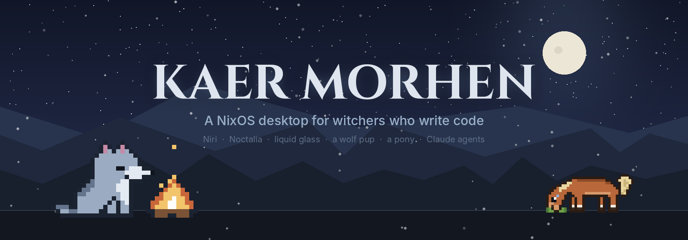
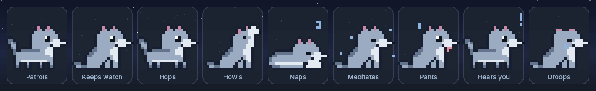
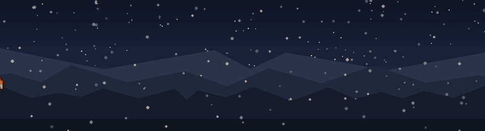
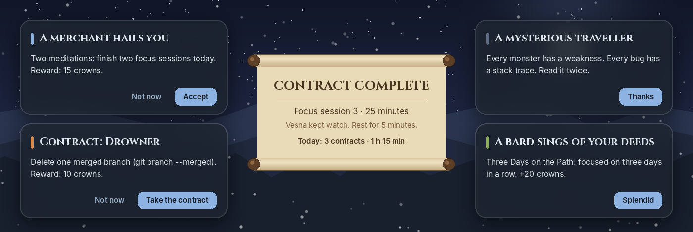
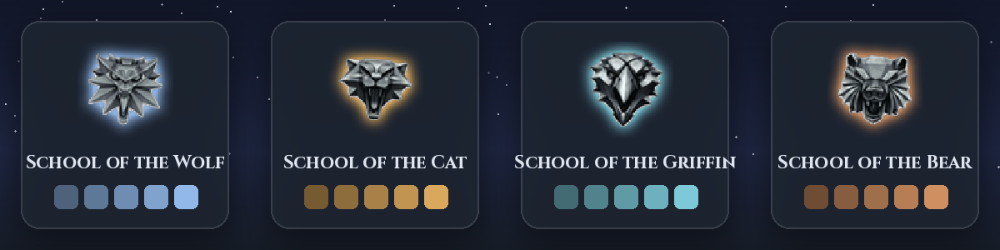
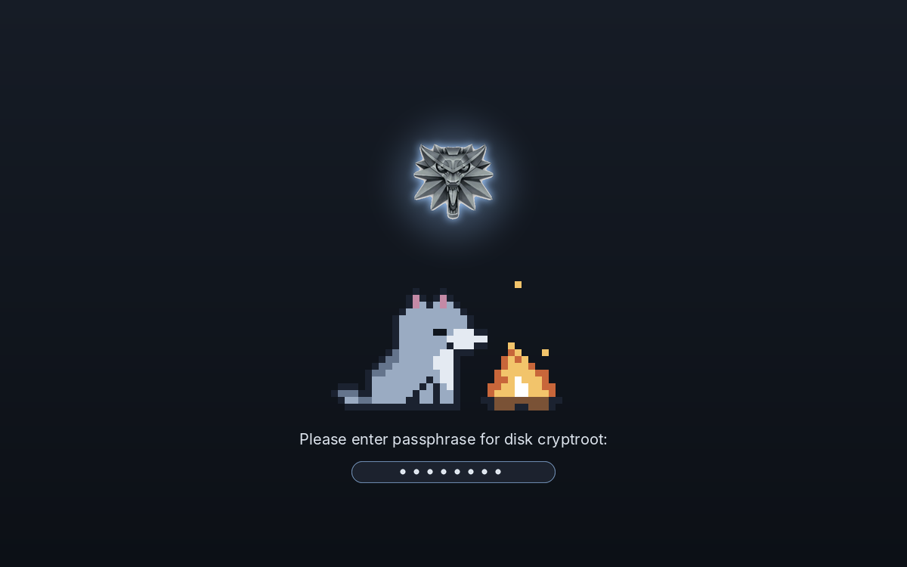
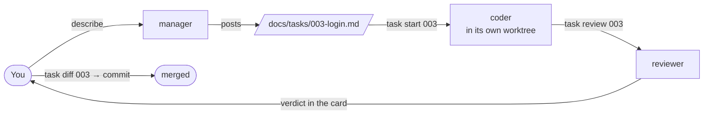

<p align="center">
  
</p>

<p align="center">
  <a href="https://nixos.org"></a>
  <a href="https://github.com/YaLTeR/niri"></a>
  <a href="https://github.com/noctalia-dev/noctalia-shell"></a>
  <a href="https://claude.com/claude-code"></a>
</p>

<p align="center">
  <b>A fully declarative NixOS + Home Manager setup for a ThinkPad X1 Yoga Gen 7.</b><br>
  Frosted "liquid glass" on a scrollable tiling desktop, a pixel wolf pup in the bar,
  a pony who brings your build results, rare encounters with a bestiary,
  and a Claude Code workflow where agents take contracts and you keep the coin.
</p>

<!-- SCREENSHOT: uncomment once docs/screenshots/desktop.png exists (see docs/screenshots/README.md)
<p align="center"></p>
-->

---

## ✦ Highlights

| | |
|---|---|
| 🐺 **Vesna** | A wolf pup who lives in the bar and reacts to what you do |
| 🐴 **Sigurd** | A pony who trots along the screen edge with jokes, tips and finished builds |
| ⚔️ **Encounters** | About five a day: merchants, monster contracts, travellers, badges, all kept in a bestiary |
| 🏰 **Schools** | Wolf, Cat, Griffin, Bear: each changes the accent colour, medallion and hum |
| 🌗 **Day & night** | Wallpaper tinted to your real sunrise and sunset |
| ⏳ **Focus** | 25-minute sessions: Vesna meditates, a parchment scroll marks the contract done |
| 📜 **Claude agents** | Manager, coder and reviewer agents in git worktrees. They never commit for you |
| 🔥 **Boot to lock** | Custom Plymouth campfire, glass lock screen, morning brief on first login |

---

## 🐺 Vesna, the pup in the bar

<p align="center"></p>

Vesna patrols her strip of the bar, sits by the clock and blinks. She also:

- **naps** after two minutes without input and wakes up when you're back
- **hops** when a build, a test run or an agent turn succeeds, and **droops** when one fails
- **pricks her ears** at notifications and **pants** when the CPU runs hot
- **howls** at midnight
- **meditates** during focus sessions, with the countdown next to her

Click her for a trick. Right-click her to start or stop a focus session.

<!-- SCREENSHOT: docs/screenshots/bar.png
<p align="center"></p>
-->

## 🐴 Sigurd, the pony

<p align="center"></p>

Every 40 minutes or so (between 9:00 and 22:00) Sigurd wanders along the bottom of the screen.
He grazes for a while, then trots off. Click him for a joke, a tip or a shortcut button.

When `rebuild`, `b` (build) or `t` (test) runs **longer than a minute**, he brings the result.
He is a small GTK4 layer-shell overlay. He only takes clicks on himself and his bubble, and he
stays hidden behind fullscreen windows.

```bash
sigurd visit                 # call him over
sigurd say "Lunch time"      # make him carry a message
```

## ⚔️ Encounters & the bestiary

<p align="center"></p>

A few times a day a card appears in the corner, together with a chime and Sigurd:

- **Merchant:** a daily challenge the system checks for you: focus sessions, a clean rebuild, a passing test, three commits, a contract moved to review
- **Monster contract:** a small real task, like *"delete one merged branch"* or *"clear five TODOs"*. Accept it, then mark it **Slain** when it's done
- **Mysterious traveller:** a saying or a tip for this machine
- **Badge:** a rare reward for something you actually did: first meditation, a three-day streak, 25 clean rebuilds, wearing all four medallions

Challenges, monsters and badges pay **crowns**. **Super+Shift+A** opens the bestiary: your purse,
today's challenge with a progress bar, open contracts, badges (locked ones show as `???`) and every
creature you've met.

Encounters are rare (at most 5 a day), never appear during focus, while idle or while locked, and
any card can be dismissed. `encounters off` pauses them. Frequency and hours are set in
[`kaer-morhen.nix`](modules/home/kaer-morhen.nix).

<!-- SCREENSHOT: docs/screenshots/bestiary.png
<p align="center"></p>
-->

## 🏰 Witcher schools

<p align="center"></p>

Scroll on the medallion in the bar, or run `school cat`. The whole shell switches palette.
The medallion and its hum change with it, and the medallion **trembles** when a Claude agent is
waiting for your answer.

## ⏳ Focus sessions

**Super+M**, `focus`, or right-click Vesna. Each session is 25 minutes, followed by a 5-minute rest
(15 after every fourth). When a session ends, a *Contract complete* scroll unrolls with today's
tally. The bar shows the countdown the whole time.

## 🔥 From boot to desktop

<p align="center"></p>

- **Boot:** a Plymouth theme with a breathing medallion and Vesna by a flickering campfire. The disk passphrase is entered right there
- **Lock screen** (Super+Esc): glass clock and date, the campfire, and how long you were away when you come back
- **Morning brief:** on the first login of the day you get the weather, your contracts, repos with uncommitted or unpushed work, and battery health
- **Day & night:** the wallpaper gets a dawn, day, dusk or night tint, timed by the real sun at your coordinates

<!-- SCREENSHOT: docs/screenshots/lock.png and docs/screenshots/brief.png
<p align="center">
  
  
</p>
-->

## 📜 Claude Code: contracts, not chaos

Development runs on a small team of Claude Code agents with clear roles:



- **The alderman** (`manager`) asks questions and writes task cards. It never touches code
- **Witchers** (`task start NNN`) each work one card in a separate git worktree, so several can run in parallel
- **The trophy inspection** (`task review NNN`) checks the diff against the card's acceptance criteria
- **The coin is yours:** agents can't commit, push, merge, rebase, reset, use `sudo`, or read `.env` and SSH keys
- **Silver and steel:** language servers (TypeScript, Python, Rust) and a lint hook run after every edit. Unused imports are removed, and anything else goes straight back to the agent
- **Omens:** the medallion hums when an agent needs you, and Vesna hops when one finishes

The full guide, the **Witcher's Codex**, opens with **Super+G**. A **contract board** on the desktop
lists every task card across your repos, and **the Forge** shows your Docker containers.

<!-- SCREENSHOT: docs/screenshots/codex.png
<p align="center"></p>
-->

## ⚗️ Daily life in the keep

| Command | What it does |
|---|---|
| `rebuild` / `update` | Apply the config / update inputs. Each run "brews a potion" |
| `codework` · `codepersonal` | Fuzzy-jump to a repo |
| `dev` · `b` · `t` · `i` | Dev server · build · test · install, with the right package manager |
| `newproj work api node` | New repo with a Nix dev shell (`node`, `expo`, `python`, `rust`) |
| `manager` · `task …` | The agent workflow |
| `focus` · `brief` · `school` | Focus session · morning brief · change school |
| `bestiary` · `encounters [on\|off\|now]` | Crowns and badges · encounter control |
| `ranger [travel\|home]` | Power saver and dim screen · charge to 100% once · back to the 80% limit |
| `pg` · `redis` · `ports` | Throwaway databases in Docker · what's listening |
| `cleanup` · `gens` | Keep the last 3 system versions · list them |

| Key | Action |
|---|---|
| **Super + /** | Cheatsheet of every key and command |
| **Super + G** | Witcher's Codex (agent guide) |
| **Super + M** | Focus session |
| **Super + Shift + A** | Bestiary |
| **Super + Shift + B** | Morning brief |
| **Super + Esc** | Lock |
| **Super + Shift + G** | Terminal: frost ↔ dark glass |
| **Super + Shift + W** | Move and edit desktop widgets |

Also included: Ranger mode (a control-centre tile with battery health), an 80% charge limit, KDE
Connect for Android, an external-monitor profile, frosted Ghostty terminals and Starship.

---

## 🧱 Under the hood

| Layer | Choice |
|---|---|
| OS | NixOS unstable, flakes, Home Manager, disko (LUKS2 + Btrfs) |
| Compositor | [Niri](https://github.com/YaLTeR/niri): scrollable tiling, blur, rounded glass |
| Shell | [Noctalia](https://github.com/noctalia-dev/noctalia-shell) 5.3: bar, panels, lock screen, launcher, plus a custom Luau plugin |
| Theming | Stylix + one palette file ([`theme/palette.nix`](theme/palette.nix)) |
| Companions | Luau plugin (Vesna, medallion, encounters, panels) · Python + GTK4 layer shell (Sigurd) |
| Dev | Per-project dev shells via `nix-direnv`, Docker, Claude Code with LSP plugins and hooks |

```
flake.nix                 inputs and outputs
settings.nix              the only file you must edit: user, disk, city, emails
hosts/x1-yoga/            hardware and disk layout
modules/system/           boot (Plymouth), power, desktop, greeter, dev tools
modules/home/             niri, noctalia, terminal, shell, Claude, Kaer Morhen, Sigurd
theme/
  palette.nix · schools.nix      colours
  witcher-plugin/                the Noctalia plugin: Luau, sprites, sounds, art generators
  sigurd/                        the pony overlay app and its frames
  plymouth/                      boot theme
templates/                dev-shell flakes for new projects
docs/                     README art and its generator
```

All sprites, sounds and the boot art are generated by small Python scripts in `theme/*/art`. The
README images come from [`docs/art/make_readme_images.py`](docs/art/make_readme_images.py).

## 🛠️ Install

> [!WARNING]
> Installing wipes the target disk.

1. Boot the NixOS installer, connect to the internet, then clone:
   ```bash
   git clone https://github.com/KostrxGit/nixos.git && cd nixos
   ```
2. Edit [`settings.nix`](settings.nix): username, disk (`lsblk`), time zone, city and coordinates, git emails.
3. Partition, encrypt and install:
   ```bash
   sudo nix --experimental-features "nix-command flakes" run github:nix-community/disko -- \
     --mode destroy,format,mount --argstr disk /dev/nvme0n1 hosts/x1-yoga/disko.nix
   sudo nixos-install --flake .#x1
   ```
4. Reboot, log in, and press **Super + /**.

Built for an X1 Yoga Gen 7 (3840×2400 at 2.5× scale). On other hardware, replace
`hosts/x1-yoga/hardware-configuration.nix` and adjust the monitor block in `modules/home/niri.nix`.
Drop your own wallpaper into `theme/wallpapers/witcher.jpg`. Without one, a generated slate gradient is used.

---

<p align="center">
  <sub>
    A personal fan project. <i>The Witcher</i> and its names belong to CD PROJEKT RED and Andrzej Sapkowski;
    this repo is not affiliated with or endorsed by them. Vesna, Sigurd and all pixel art are original.
  </sub>
</p>
